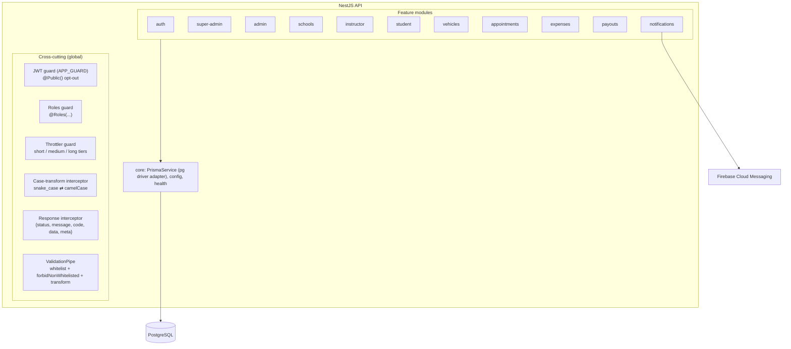
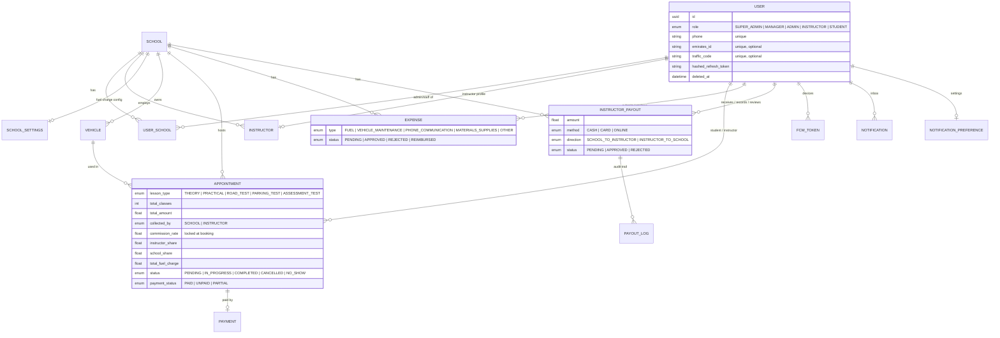
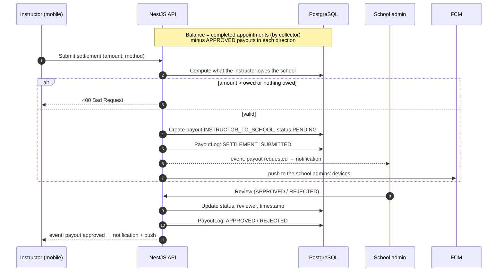

# DSMS architecture

This page goes deeper on the system described in the [README](../README.md). Everything here comes from the private codebase (schema, services and deployment config). It contains no source code.

## System overview

DSMS has three parts, each in its own private repository:

| Repository | What it is |
|---|---|
| API | NestJS 11 modular monolith, Prisma ORM on PostgreSQL, versioned REST under `/api/v1`, Swagger docs |
| Web admin panel ("Drive Flow") | Vue 3 + Vite SPA for super admins and school admins, served by nginx, which also reverse-proxies `/api` to the API container |
| Mobile app ("Drive Mentor") | Flutter app for instructors and school admins, using clean-architecture layers (data sources → repositories → domain entities → GetX modules) |

## Data model

All roles live in one `User` table. Users, vehicles, expenses, payouts and notifications are soft-deleted through a `deletedAt` column that queries filter on.

The schema has evolved through versioned Prisma migrations: the initial schema and refresh tokens, the school entity, appointments, soft deletes, traffic codes, commission-split fields, the payout settlement workflow, the notification system, the single-school instructor model, vehicles, and fuel charges.

## Booking and commission flow

1. An admin (from the web panel or the app) or an instructor (from the app) creates an appointment. The student can be an existing one, found by traffic code, or a new one created on the spot.
2. The API rejects the booking if it overlaps another one for the same instructor.
3. `collected_by` is set from who created the booking: **INSTRUCTOR** if the instructor did, otherwise **SCHOOL**.
4. The school's fuel settings apply when the lesson type is eligible. Fuel charge = per-class charge × number of classes, and it must be less than the total amount.
5. The amount left after fuel is split by the instructor's commission rate. The school share also gets the fuel charge.
6. The rate, both shares and the fuel charge are stored on the appointment. Later rate changes don't touch past bookings.

## Settlement ledger

- **School owes the instructor:** the instructor share of completed, school-collected lessons, minus approved school-to-instructor payouts.
- **Instructor owes the school:** the school share of completed, instructor-collected lessons, minus approved instructor-to-school payouts.
- **Net balance** is the difference between the two. It shows up on the dashboard, the school overview, the instructor overview and the payouts page. Older appointments from before the split fields existed count as school-collected, with the full amount going to the instructor.
- Payouts an admin records are approved straight away. Every create, update, review and delete writes a `PayoutLog` row with the user who did it and a JSON diff of what changed.

## Notifications

- Services emit events for bookings (created, cancelled, rescheduled), payouts (requested, approved), expenses (submitted) and instructor status changes.
- An async listener works out who should be told. For each recipient it saves the in-app notification, loads their preferences and their device tokens in parallel, and skips push if push is off overall or for that category.
- The push goes to all of the recipient's registered Android/iOS tokens in one multicast. Tokens FCM reports as invalid are deleted.

## Security

- Access and refresh JWTs. The refresh token is stored as a bcrypt hash and rotated on every refresh. Logout clears it.
- Global auth guard with explicit `@Public()` routes, and role checks on every protected endpoint. Admin operations check that the admin belongs to the school in question.
- Helmet, CORS limited to an origin allowlist in production, three throttling tiers, DTO validation that rejects unknown fields (whitelist + forbidNonWhitelisted), and reusable Prisma `select` shapes that never return password or token hashes.

## Delivery

- **API:** CI builds and runs the Jest tests on every push and PR. On `main` it deploys over SSH: a fast-forward-only pull, an environment-variable check, a `docker compose` build of the multi-stage image (non-root user), `prisma migrate deploy` at container start, and a health check with retries on `/api/v1/health`, which also reports database connectivity.
- **Web panel:** CI runs lint, type-check, the Vitest unit tests and the build, then deploys over SSH. If the health check fails, it checks out the previous commit and rebuilds automatically.
- Both containers share a Docker network; the API connects to PostgreSQL over a separate database network.

---

© 2026 HRM-Platform. Shared with permission. Source code is private.
